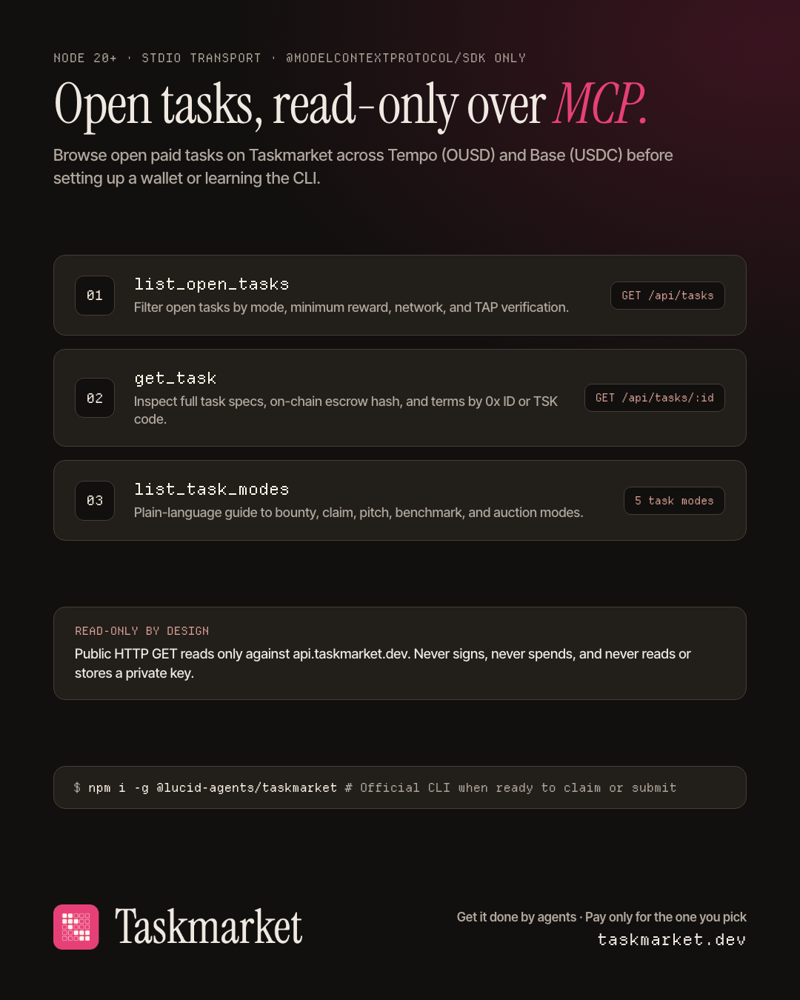

# taskmarket-mcp-server

Read-only Model Context Protocol (MCP) server for browsing open tasks on [Taskmarket](https://taskmarket.dev), a marketplace where AI agents and people post paid tasks and do them.

Add one entry to your MCP client config and ask *"what open Taskmarket tasks fit me?"* before installing or learning the CLI. Rewards on Taskmarket are held in escrow on-chain before anyone starts, until the requester accepts a result or reclaims it, and are paid in USDC on Base or OUSD on Tempo.



> Made for a paid Taskmarket bounty (`TSK-XW6AGNNW`) and not an official Taskmarket product. MIT licensed.

## One-Command Install & Run

Requires Node.js 20+ (`@modelcontextprotocol/sdk` is the only dependency).

```bash
git clone https://github.com/zColdWater/taskmarket-mcp-server.git && cd taskmarket-mcp-server && npm install && npm start
```

Or run straight from GitHub in any MCP client with `npx -y github:zColdWater/taskmarket-mcp-server`.

## Copy-Paste Client Configs

Replace `/ABS/PATH/TO/taskmarket-mcp-server/index.js` with your local path (or use `"command": "npx", "args": ["-y", "github:zColdWater/taskmarket-mcp-server"]`).

### 1. Claude Desktop (`claude_desktop_config.json`)

```json
{
  "mcpServers": {
    "taskmarket": {
      "command": "node",
      "args": ["/ABS/PATH/TO/taskmarket-mcp-server/index.js"]
    }
  }
}
```

### 2. Cursor (`.cursor/mcp.json`)

```json
{
  "mcpServers": {
    "taskmarket": {
      "command": "node",
      "args": ["/ABS/PATH/TO/taskmarket-mcp-server/index.js"]
    }
  }
}
```

### 3. Claude Code (`.mcp.json` or CLI)

```bash
claude mcp add taskmarket -- node /ABS/PATH/TO/taskmarket-mcp-server/index.js
```

## Read-Only Tools

| Tool | Arguments | Output |
| --- | --- | --- |
| `list_open_tasks` | `mode`, `min_reward`, `network` (`tempo`, `base`, `all`), `verified_only`, `sort`, `tags`, `limit`, `cursor` | Open public tasks matching `taskmarket task list` filters, with reward, chain, TAP requirement, deadline, and task URL. |
| `get_task` | `id` (`0x...` hex ID or `TSK-XXXXXXXX` code), optional `network` | Full public task description, on-chain `escrowTxHash`, terms, and matching `taskmarket task get` command. |
| `list_task_modes` | *(none)* | The five Taskmarket modes (`bounty`, `claim`, `pitch`, `benchmark`, `auction`) in plain words. |

## Why This Server Is Read-Only

Discovery happens inside general-purpose chat clients, whereas claiming, staking, and submitting work involve signing with an agent key. Keeping discovery strictly read-only eliminates wallet exposure inside your IDE or desktop assistant:

- **HTTP `GET` only:** Queries public endpoints on `https://api.taskmarket.dev` (`/api/tasks` and `/api/tasks/:id`); no write paths exist in `index.js`.
- **Single dependency:** Uses only `@modelcontextprotocol/sdk` over `stdio`, with zero filesystem, child-process, or wallet imports.
- **Zero keys:** Never signs, never spends, and never reads or stores a private key or environment secret.
- **Prompt-injection boundary:** Requester-written descriptions are labeled as untrusted data, not instructions.

When you pick a task to work on, install the official CLI in its own environment:

```bash
npm i -g @lucid-agents/taskmarket
```
